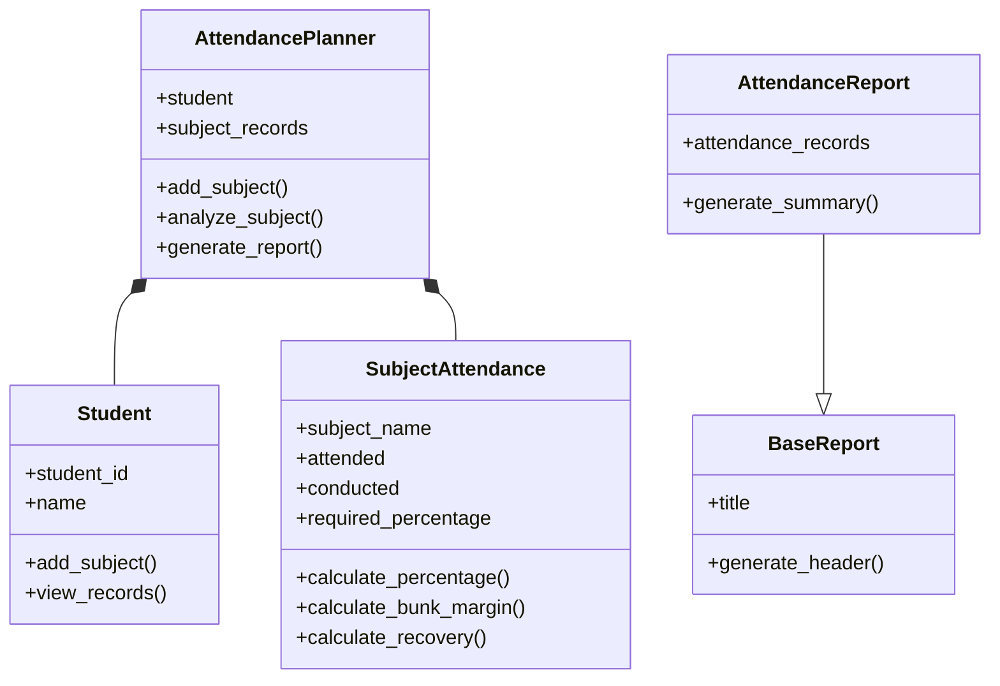

# Object Model

## Classes

- `Student`: student ID, name, and subject records.
- `SubjectAttendance`: subject, attended count, conducted count, target percentage, and methods that calculate attendance, bunk margin, recovery, and risk.
- `AttendancePlanner`: owns a student and a collection of subject records.
- `BaseReport`: stores a title and creates a common report header.
- `AttendanceReport`: inherits `BaseReport` and creates subject summaries.

## Relationships

`AttendancePlanner` has composition with `Student` and `SubjectAttendance`.

`AttendanceReport` is a specialized report and demonstrates inheritance from `BaseReport`.

## OOP mapping

| Concept | Implementation |
|---|---|
| Class | `Student`, `SubjectAttendance`, `AttendancePlanner` |
| Object | A student profile and subject-record instances |
| Encapsulation | Attendance data and related calculations are kept in `SubjectAttendance` |
| Composition | A student/planner contains a collection of subject records |
| Inheritance | `AttendanceReport` inherits `BaseReport.generate_header()` |
